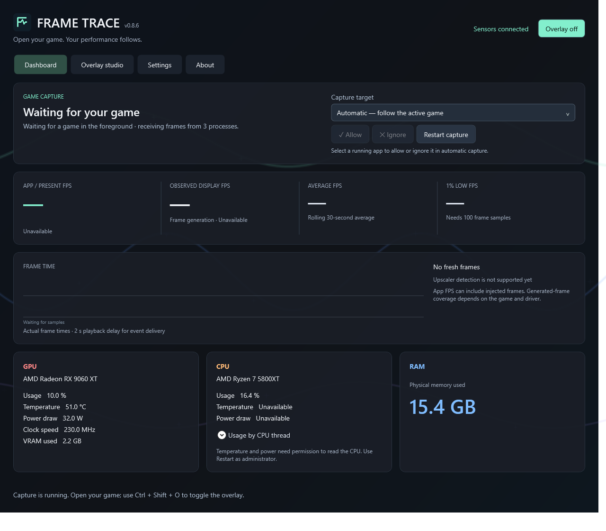
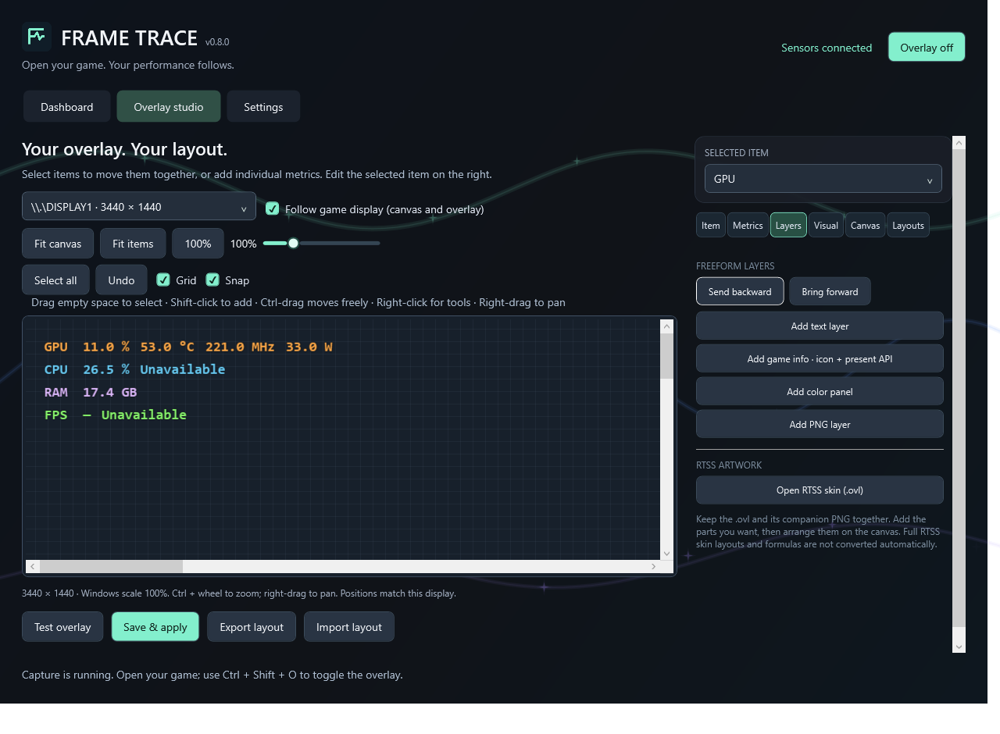
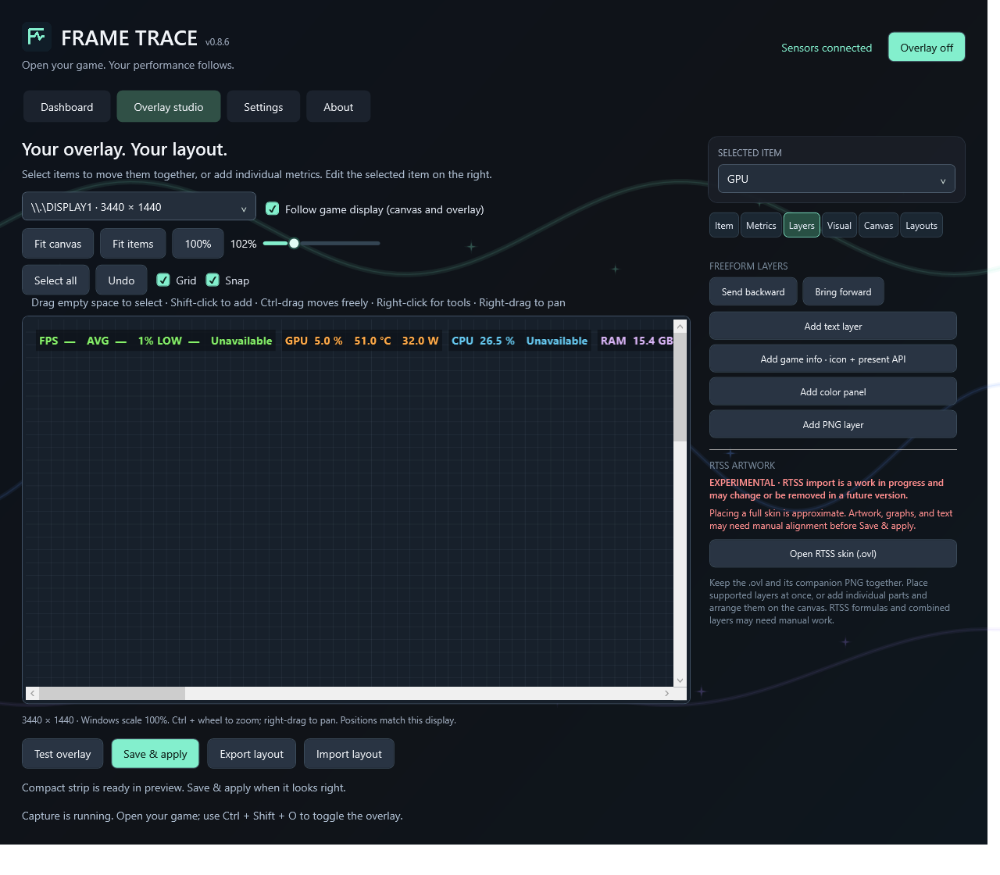
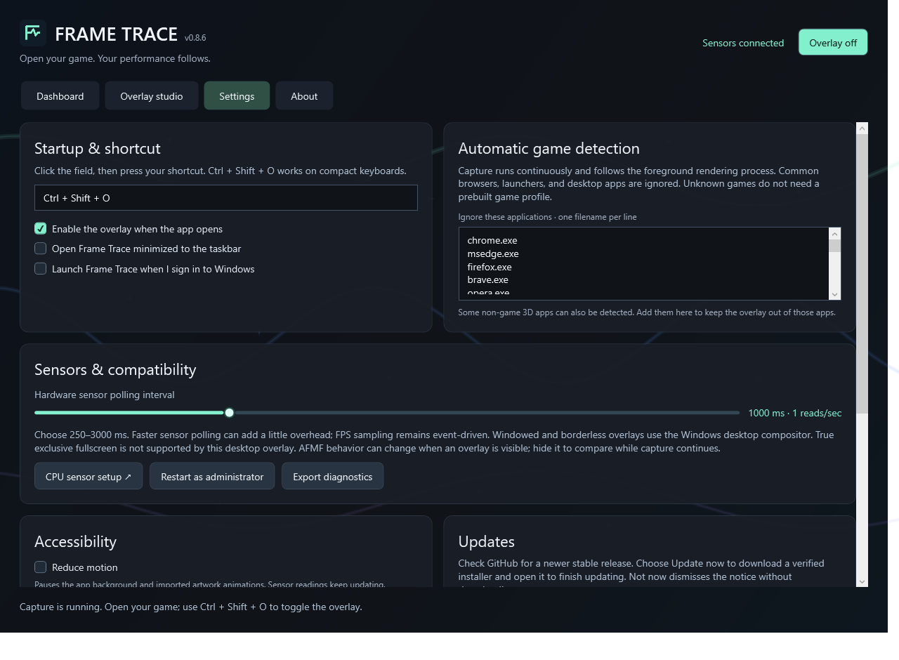
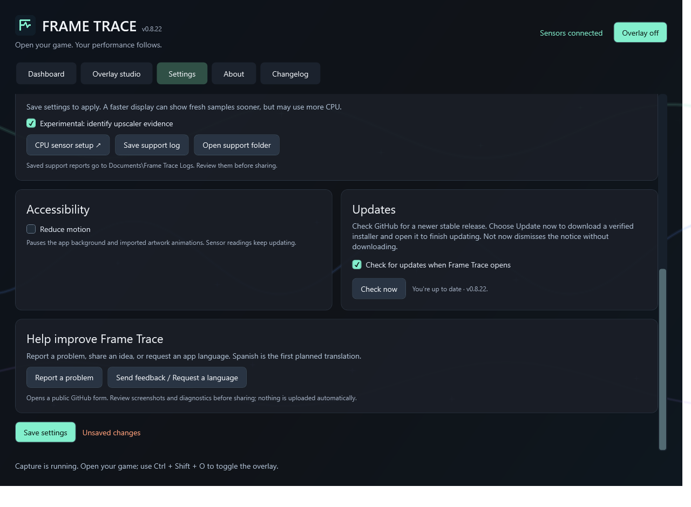
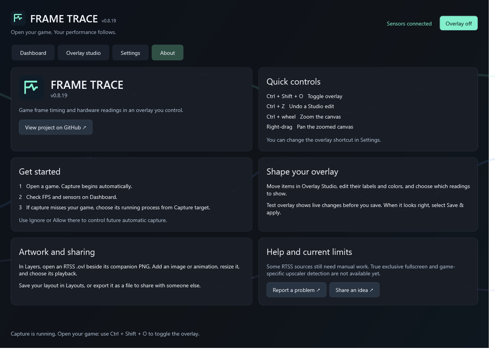

<p align="center"></p>
<h1 align="center">Frame Trace</h1>
<p align="center"><strong>Open your game. Your performance follows.</strong><br>Free, open-source Windows performance dashboard and customizable gaming overlay.</p>
<p align="center"><a href="https://github.com/itourboy-OG/FrameTrace/releases/latest"></a> <a href="LICENSE"></a> </p>

<table>
  <tr>
    <td align="center"><strong>Dashboard</strong><br></td>
    <td align="center"><strong>Overlay Studio</strong><br></td>
  </tr>
  <tr>
    <td align="center" colspan="2"><strong>Compact Strip layout</strong><br></td>
  </tr>
  <tr>
    <td align="center" colspan="2"><strong>Settings</strong><br></td>
  </tr>
  <tr>
    <td align="center" colspan="2"><strong>Settings · accessibility, updates and feedback</strong><br></td>
  </tr>
  <tr>
    <td align="center" colspan="2"><strong>About and quick controls</strong><br></td>
  </tr>
</table>

## Get Frame Trace

Download the Windows x64 installer from [Releases](https://github.com/itourboy-OG/FrameTrace/releases/latest). Frame Trace checks for newer stable releases when it opens (optional) and from **Settings → Check now**. A compact notice offers **Update now** or **Not now**. Update now downloads the installer with percentage progress, verifies its size and SHA-256 against GitHub's release metadata, and opens Windows Setup to finish updating. Frame Trace closes cleanly before installation. Not now dismisses the notice without downloading. The updater goes directly to the latest stable release, even from an older version; updates never start without your choice.

The installer is unsigned in this early release, so Windows may show a SmartScreen warning. Review the source and release details before installing.

## What works today

- **Automatic capture:** follows the foreground application that is presenting frames. The capture picker marks processes producing live FPS, and you can select one manually if automatic detection misses it. The dashboard shows frame freshness, available AFMF capture tags, and AMD service status when installed. It can also allow or exclude a selected executable from future automatic capture. You do not need to choose an executable file or start capture manually.
- **Frame performance:** game/present FPS, observed on-screen FPS, rolling average, 1% low, frame time, and a live frame-time graph. When PresentMon provides instrumented frame timing, Frame Trace separates game FPS from DLSS-generated output FPS. The live number uses recent frames so it reacts faster to scene changes; the average and 1% low retain longer histories. Without suitable timing or frame tags, **Captured FPS** may include generated frames.
- **Hardware readings:** GPU load, temperature, power, clock, and VRAM; CPU load, temperature, and power where the sensor driver exposes them; physical RAM used.
- **Experimental upscaler clues:** an optional Settings switch reads Cyberpunk 2077's saved upscaler, quality preset, and frame-generation choice. In other games, it may only recognize loaded AMD FSR, Intel XeSS, or NVIDIA DLSS libraries. On supported NVIDIA drivers, read-only preset reporting can show separate DLSS Super Resolution, Frame Generation, and Ray Reconstruction overrides when available. Overlay Studio lets you confirm and rename the upscaler and frame-generation text for a selected game; these are saved by executable and are not automatic verification.
- **Overlay Studio:** drag or group-select items, add separate metrics and freeform text or artwork layers, rename labels, adjust colors, fonts, sizes, graphs, and opacity. Match the canvas to your monitor, use the grid and snapping, save or delete named presets, and test edits live. Hover help explains Studio controls; double-click sliders with stated defaults to reset them. The Undo button or Ctrl+Z on the canvas restores the preceding layout edit; Ctrl+Z still undoes text while editing a text field. Unsaved-edits prompts protect work before replacing a layout.
- **Graphical layouts:** ten built-in presets include the compact horizontal strip and a vertical GeForce telemetry rail. Live usage bars, gauges, graphs, GPU fan artwork, temperature alarms, and a game-name/icon/presentation-API item can be positioned on the canvas. Import an RTSS `.ovl` skin with its companion PNG, preview each artwork choice beside the list, and place supported artwork, animations, graphs, and bars from its layer positions; adjust the result or add individual pieces in Frame Trace.
- **Settings:** customize the overlay shortcut and startup state, launch at Windows sign-in, start minimized, reduce background motion, ignore selected processes, adjust sensor polling and the separate FPS display update interval, and choose whether to check for updates on startup.
- **Support logs and changelog:** Settings can save a ZIP containing current diagnostics and recent error events to `Documents\Frame Trace Logs`, or open that folder for you. The Changelog tab shows recent published releases and their notes.
- **Background work:** the decorative animation pauses when minimized or hidden. Capture and configured sensor polling continue, while hidden dashboard, studio, and overlay displays skip their refresh work. Visible graphs keep their real timestamps and stop requesting redraws when hidden or empty.
- **Updates:** checks the public GitHub Releases API, offers an optional installer download with percentage progress and checksum verification, and starts Windows Setup after you choose Update now. Failed or canceled downloads are not installed. It does not upload performance readings.

The Windows smoke suite passes locally, including real PresentMon capture, sensor reads, process selection, the Overlay Studio, and its ten layouts. That does not establish compatibility with every PC or game.

### In-game technology checks so far

Cyberpunk has a readable local graphics-settings file, so Frame Trace can show its saved selection and preset, including XeSS when selected. It can also show the saved frame-generation On/Off choice when that setting is present. Other games store settings differently; a loaded upscaler library alone cannot reveal the active mode or quality preset. Protected games may block module inspection. These results concern **in-game technology information**, not whether FPS capture or the overlay works in each game.

| Game | Upscaler information | Frame-generation information |
| --- | --- | --- |
| Cyberpunk 2077 | Saved FSR, DLSS, or XeSS choice and quality preset; player checked FSR 4, XeSS, and NVIDIA DLSS preset reporting | Saved FSR 3, DLSS, or XeSS FG On/Off choice when available; player checked NVIDIA DLSS FG preset reporting and the game/display FPS split in one scene |
| Mafia: The Old Country | NVIDIA presets appeared, but the upscaler was labeled XeSS while the player selected DLSS or FSR in-game; active upscaler identification is incorrect in this test | Player saw NVIDIA FG preset reporting; generated-output FPS was not checked |
| Overwatch | Player saw AMD FSR runtime loaded; active mode and version unknown | Not identified |
| Battlefield 6 | Game-module inspection was unavailable in the player's test | Not identified |
| Forza Horizon 6 and the player-reported “Resonance of a Plagued Tale Legacy” | Player saw AMD FSR runtime loaded; active mode and version unknown | Not identified |

Overlay Studio's upscaler and frame-generation confirmations can be renamed for each game (for example, DLSS 4.5 and DLSS FG). They remain **manual labels**, not automatic detection. Results can change with game updates, drivers, and permissions. More games need testing, and no result in this table guarantees the displayed FPS includes generated frames.

## Known limitations

- **Active in-game upscaler output is not verified.** The experimental check reads Cyberpunk 2077's saved choices or recognizes known loaded libraries in other games. A game setting can be overridden by a mod or driver, and a loaded library does not prove it is active. Mafia: The Old Country was mislabeled XeSS in a player test. NVIDIA override preset readings depend on the driver and game; they do not identify every active technology or OptiScaler's input/output configuration. Per-game labels are user-provided. Leave process-module inspection off in anti-cheat games unless their rules permit it.
- **RTSS import is experimental and partial.** It may change or be removed. Supported artwork and live widgets can use the skin's layer positions, but placement is approximate and may need manual alignment before saving. Custom formulas, combined RTSS instructions, and unsupported tables still require manual work. Keep the `.ovl` and companion PNG together when importing.
- **Frame generation identification depends on data reported by the capture path.** AFMF 2.1 and Intel XeSS-FG can be identified when PresentMon reports their tags. Cyberpunk's saved FSR 3, DLSS, or XeSS FG On/Off setting is separate from a verified runtime reading. Instrumented NVIDIA frame timing separated game FPS from DLSS output FPS in one Cyberpunk test, but that split is not guaranteed in other games. Missing data means unknown, not disabled.
- **True exclusive fullscreen is not supported by the desktop overlay.** Capture may still report frame data. Windowed and borderless games use the Windows desktop compositor; behavior can vary by title and driver.
- **Returning to a game after Alt+Tab may vary by title.** Frame Trace attempts to bring the overlay above the game when focus returns. The dark native title bar requires Windows 11; Windows 10 retains its system title bar.
- **Anti-cheat compatibility has not been certified.** Frame Trace does not inject code into games, but that alone cannot guarantee that every anti-cheat permits an overlay. Competitive-game compatibility and account safety have not been verified; follow each game's rules.
- **Hardware support varies.** Sensor availability depends on the hardware, driver, permissions, and sensor driver. Broader AMD and NVIDIA testing is still needed.
- **The installer is not code-signed.** SmartScreen may require an additional confirmation.

## Settings and privacy

Frame Trace stores preferences locally in `%LOCALAPPDATA%\FrameTrace`. On first startup after an upgrade, it renames the legacy `Frameglass` data folder, preserving preferences, custom presets, and diagnostics. If both folders exist, startup reports the conflict and leaves them unchanged. The update check makes a normal HTTPS request to GitHub for the latest public release; it sends the app's version in the request header and does not send hardware data, game names, or frame readings. Automatic checking can be disabled in Settings; **Check now** remains available.

Installer downloads are saved under `%LOCALAPPDATA%\FrameTrace\Updates` only after you choose **Update now**. Their size and SHA-256 checksum are checked before Windows Setup is opened. Closing Frame Trace during a download cancels it and removes the partial file.

Frame Trace keeps a rotating event log in `%LOCALAPPDATA%\FrameTrace\diagnostics.jsonl` (the Preview uses `%LOCALAPPDATA%\FrameTracePreview`). Unhandled app errors are recorded there when Windows can deliver them; a hardware or driver crash may end the process without an app log. Choose **Settings → Save support log** to make one ZIP with the current diagnostic state and recent events, defaulting to `Documents\Frame Trace Logs`. **Open support folder** opens that folder. Nothing is uploaded automatically. Reports can contain hardware readings, process names, error details, and recent frame data, so review them before sharing.

Overlay layout exports share overlay appearance and positions without sharing your hotkey, ignored-app list, per-game technology confirmations, Windows startup choice, or update preference. Importing a layout leaves those local settings unchanged.

## Build from source

Requirements: Windows 10 or later, .NET 9 SDK, and Inno Setup 6.

```powershell
./build.ps1
./artifacts/app-0.8.32/FrameTrace.exe --smoke-test C:/path/to/test-results
```

The build creates a self-contained Windows x64 application and per-user installer. It downloads PresentMon 2.6.0 when needed and verifies its SHA-256 before packaging. The smoke test writes a `result.txt` report and screenshots; it uses real local sensors and ETW capture but does not validate every game or anti-cheat.

## Roadmap

- Validate AFMF 2.1 gameplay after the performance changes, including displaying the overlay on a second monitor.
- Improve RTSS skin import for custom formulas and advanced widgets.
- Test capture and overlay behavior across more games, graphics cards, drivers, and display modes.
- Verify that the overlay remains visible after returning to Cyberpunk 2077 from another window.
- Explore reliable, cooperative reporting of in-game DLSS, FSR, XeSS, and frame-generation settings.
- Improve the dashboard, accessibility options, and update experience based on player feedback.

## Source and contributions

Frame Trace's source code is licensed under [MIT](LICENSE). Third-party components keep their own licenses; see `vendor/` notices and the packaged `ThirdPartyNotices.txt`.

### Feedback and bug reports

Have an idea, question, or problem to report? [Open a GitHub issue](https://github.com/itourboy-OG/FrameTrace/issues/new/choose) and choose **Bug report** for something that is not working, or **Feedback or language request** for ideas, general feedback, and language requests. Fill in the form and submit it; you do not need to know Git or write code. If you are unsure which option fits, use the feedback form. If someone has already reported the same thing, add a comment to that issue instead.

Inside the app, **Settings → Help improve Frame Trace** opens these forms through **Report a problem** or **Send feedback / Request a language**. Nothing is uploaded automatically.

Issues are public. Do not include passwords, account details, or other private information. A diagnostics file is optional; review it first because it can contain hardware readings, process names, and recent frame data. See [Settings and privacy](#settings-and-privacy) for details.

More app languages may be added based on community interest. **Spanish is the first planned translation.** Use the feedback form to request another language or offer help with a translation.

Pull requests are welcome from people who want to propose code changes, but they are not required to report a problem or share feedback.
